# StockPilot: end-to-end DevOps capstone

StockPilot is a small inventory tracker where you can add products, adjust stock, and see what needs
reordering. The application is kept simple on purpose. Most of the work is in the platform around it,
which takes a commit from a laptop to a monitored, autoscaling, GitOps-managed Kubernetes cluster on
AWS, with security gates at every step.

```
Application → Git → GitHub → CI → Build & Test → Security Scanning → Docker Image
  → Container Registry → Kubernetes → Helm → Monitoring → GitOps
```

## Table of contents
1. [Project overview](#1-project-overview)
2. [Architecture](#2-architecture)
3. [Technologies used](#3-technologies-used)
4. [Repository structure](#4-repository-structure)
5. [Application setup](#5-application-setup)
6. [Docker setup](#6-docker-setup)
7. [Kubernetes deployment](#7-kubernetes-deployment)
8. [Helm deployment](#8-helm-deployment)
9. [Terraform infrastructure](#9-terraform-infrastructure)
10. [CI/CD pipeline](#10-cicd-pipeline)
11. [DevSecOps implementation](#11-devsecops-implementation)
12. [Monitoring](#12-monitoring)
13. [GitOps](#13-gitops)
14. [Troubleshooting](#14-troubleshooting)
15. [Screenshots](#15-screenshots)
16. [Lessons learned](#16-lessons-learned)

## 1. Project overview

| | |
|---|---|
| App | FastAPI REST API + PostgreSQL + a static Vite/Nginx frontend |
| Infra | AWS VPC + EKS provisioned by Terraform |
| Delivery | GitHub Actions → GHCR → Argo CD (GitOps) → Helm chart on Kubernetes |
| Security | SAST, SCA, secret scanning, IaC scanning, container scanning, all as blocking gates |
| Observability | Prometheus, Grafana, Alertmanager, Loki, Alloy |
| Resilience | Probes, HPA, PodDisruptionBudget, rolling updates with zero unavailable pods |

API endpoints:

| Method | Path | Purpose |
|---|---|---|
| GET | `/health` | Liveness: process is up (no DB call) |
| GET | `/ready` | Readiness: database reachable |
| GET | `/metrics` | Prometheus metrics |
| GET | `/api/info` | Running version (Git SHA) and environment |
| GET | `/api/items` | List products (`?low_stock=true` to filter) |
| GET | `/api/items/stats` | Totals, low-stock count, stock value |
| GET | `/api/items/{id}` | One product |
| POST | `/api/items` | Create a product |
| PUT | `/api/items/{id}` | Update a product |
| DELETE | `/api/items/{id}` | Delete a product |

Swagger UI is served at `/docs`.

## 2. Architecture

### Delivery flow

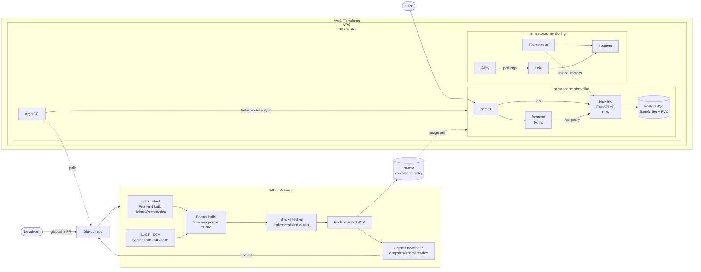

### Runtime view

```
                    ┌──────────────── EKS (private subnets) ──────────────────┐
 user ─▶ AWS LB ─▶  │ ingress-nginx ─┬─ /      ─▶ Service frontend ─▶ Nginx pods│
 (public subnets)   │                └─ /api   ─▶ Service backend  ─▶ API pods  │◀─ HPA (CPU/mem)
                    │                                                │         │
                    │             NetworkPolicy: only backend ─▶ PostgreSQL     │
                    │                                   StatefulSet + EBS gp3   │
                    │ Prometheus ◀─ ServiceMonitor ─ /metrics                   │
                    │ Loki ◀─ Alloy ◀─ pod logs          Grafana ◀─ both        │
                    │ Argo CD ◀─ watches Git                                    │
                    └───────────────────────────────────────────────────────────┘
```

## 3. Technologies used

| Area | Tools |
|---|---|
| Application | Python 3.12, FastAPI, SQLAlchemy 2, Alembic, PostgreSQL 17, Vite, Nginx |
| Testing & quality | pytest + coverage gate (≥ 80%), ruff |
| Version control | Git, GitHub, pull request template, pre-commit hooks |
| CI/CD | GitHub Actions, GitHub Container Registry (GHCR) |
| Containers | Docker (multi-stage, non-root), Docker Compose |
| Orchestration | Kubernetes 1.34, Kustomize, Helm, kind (local + CI) |
| Infrastructure as Code | Terraform, AWS VPC, EKS, IAM, EBS CSI, GitHub OIDC |
| DevSecOps | Semgrep, Bandit, pip-audit, npm audit, Dependabot, Gitleaks, Trivy (image, config, SBOM) |
| Monitoring | Prometheus Operator (kube-prometheus-stack), Grafana, Alertmanager |
| Logging | Loki, Grafana Alloy, structured JSON logs |
| GitOps | Argo CD (app-of-apps, auto-sync, self-heal) |

## 4. Repository structure

```
final-devops-project/
├── application/
│   ├── backend/            FastAPI app, Alembic migrations, pytest tests
│   └── frontend/           Vite app + nginx config template
├── docker/                 Dockerfiles (backend, frontend) + docker-compose.yml
├── kubernetes/             Plain manifests (Kustomize): Deployment, Service, ConfigMap, Secret,
│                           Ingress, HPA, probes, StatefulSet + PVC, NetworkPolicy, StorageClass
├── helm/stockpilot/        Helm chart (same objects + PDB, ServiceMonitor, alerts, dashboard, helm test)
├── terraform/              AWS VPC + EKS + add-ons + GitHub OIDC role
├── .github/
│   ├── workflows/          ci-cd.yml, terraform.yml, deploy-helm.yml, security-nightly.yml
│   └── dependabot.yml
├── security/               Scanner configs, accepted-risk register, local scan script
├── monitoring/             Prometheus/Grafana/Loki/Alloy values, dashboard, local compose config
├── gitops/                 Argo CD project, app-of-apps, per-environment values
├── troubleshooting/        14 broken scenarios + diagnostics script
├── scripts/                kind cluster, cluster bootstrap, secrets, load test
├── docs/                   Troubleshooting log, screenshots
├── docker-compose.yml      Root entry point (includes docker/docker-compose.yml)
├── Makefile                `make help` lists every shortcut
└── README.md
```

## 5. Application setup

You need Python 3.12+, Node 22+ (24 recommended), and PostgreSQL. You can also skip the local setup and
use Docker, as described in the next section.

```bash
# Backend
cd application/backend
python3 -m venv .venv && source .venv/bin/activate
pip install -r requirements-dev.txt
cp .env.example .env                        # point DB_* at your PostgreSQL
alembic upgrade head                        # create tables
uvicorn app.main:app --reload --port 8000   # http://localhost:8000/docs

# Tests (use an isolated SQLite database, never a real one)
pytest --cov=app

# Frontend (proxies /api to localhost:8000)
cd ../frontend
npm ci
npm run dev                                 # http://localhost:5173
```

Configuration comes from environment variables, following the 12-factor approach. Non-secret settings
(`DB_HOST`, `LOG_LEVEL`, ...) come from a ConfigMap and credentials (`DB_USER`, `DB_PASSWORD`) from a Secret.

## 6. Docker setup

Both Dockerfiles are multi-stage and run as non-root users.

In the backend image, the builder stage installs dependencies into a virtualenv. The runtime stage copies only
that venv and the code, upgrades OS packages, runs as UID 10001, and has a `HEALTHCHECK`.

In the frontend image, a Node stage runs `npm run build`. The runtime stage is `nginx-unprivileged`, which serves
the static files and proxies `/api` to the backend (the address is injected at start via `BACKEND_UPSTREAM`).
The final image has no Node in it.

```bash
# Whole stack: postgres → migrate (one-shot) → backend → frontend
docker compose up --build
# App http://localhost:3000   API http://localhost:8000/docs

# Add Prometheus (9090) and Grafana (3001, admin/admin) with the same dashboard as Kubernetes
docker compose --profile monitoring up --build

# Build images individually
docker build -f docker/backend.Dockerfile  -t stockpilot-backend:local  application/backend
docker build -f docker/frontend.Dockerfile -t stockpilot-frontend:local application/frontend
```

The API process does not run migrations. They run as a separate step: the `migrate` service in compose and an
init container in Kubernetes.

## 7. Kubernetes deployment

`kubernetes/` has plain manifests so each object is easy to read on its own. They deploy to the
`stockpilot-raw` namespace (Pod Security Admission level `restricted`).

| Requirement | Where |
|---|---|
| Deployment | `backend.yaml`, `frontend.yaml` (rolling update, `maxUnavailable: 0`) |
| Service | `backend.yaml`, `frontend.yaml`, `postgres.yaml` (headless) |
| ConfigMap | `configmap.yaml` |
| Secret | generated by Kustomize from `db.env` (git-ignored, random password created by `make raw-deploy`); shape in `secret.example.yaml` |
| Ingress | `ingress.yaml` (`/api` → backend, `/` → frontend) |
| HPA | `hpa.yaml` (CPU 60%, 2-5 replicas) |
| Probes | startup + liveness (`/health`) + readiness (`/ready`, checks DB) |
| Storage | PostgreSQL StatefulSet with `volumeClaimTemplates`; `storageclass-gp3.yaml` for EKS |
| Extra | NetworkPolicy (only backend → DB), non-root, read-only root FS, dropped capabilities |

```bash
# Local cluster (free): kind + ingress + metrics-server
./scripts/kind-up.sh
./scripts/bootstrap-cluster.sh --kind --no-argocd
echo "127.0.0.1 stockpilot.local raw.stockpilot.local" | sudo tee -a /etc/hosts

make raw-deploy                              # generates db.env, then kubectl apply -k kubernetes/
kubectl get pods,svc,hpa,pvc,ingress -n stockpilot-raw
# http://raw.stockpilot.local
```

## 8. Helm deployment

`helm/stockpilot` packages the same application, with a values file per environment:

| File | Use |
|---|---|
| `values.yaml` | Defaults (2 replicas, HPA on, monitoring on) |
| `values-dev.yaml` | 1 replica, debug logging, Ingress `stockpilot.local`, load endpoint on |
| `values-prod.yaml` | Bigger resources, gp3 storage, TLS, HPA 2-10, existing Secret |
| `values-ci.yaml` | For the CI smoke test (local images, no CRDs) |

Some design choices in the chart:

- Image tags are required. The chart refuses to render without an explicit commit SHA, so `latest` can never
  be deployed.
- When the HPA is enabled, the Deployment omits `replicas` so that Helm/Argo CD and the HPA don't fight over it.
- Pods roll automatically when the ConfigMap changes (`checksum/config`).
- The chart refuses to render without a database password or an existing Secret.
- ServiceMonitor and PrometheusRule are only rendered if the Prometheus CRDs exist.

```bash
./scripts/create-db-secret.sh stockpilot
helm upgrade --install stockpilot helm/stockpilot -n stockpilot --create-namespace \
  -f helm/stockpilot/values-dev.yaml \
  --set postgres.existingSecret=stockpilot-db \
  --set backend.image.tag=<git-sha> --set frontend.image.tag=<git-sha>
# shortcut for the same thing: make helm-deploy TAG=<git-sha>   (namespace stockpilot-helm)

helm list -A
helm test stockpilot -n stockpilot-helm      # runs templates/tests/test-connection.yaml
helm history stockpilot -n stockpilot-helm
helm rollback stockpilot 1 -n stockpilot-helm
```

In the GitOps flow (section 13), Argo CD renders and applies this same chart. Those releases are managed by
Argo CD, so they don't show up in `helm list`.

## 9. Terraform infrastructure

`terraform/` provisions everything Kubernetes needs on AWS (region `ap-south-1` by default):

- A VPC across 2 AZs with 2 public subnets (load balancers, NAT), 2 private subnets (nodes), 1 NAT gateway,
  and subnet tags for load balancer discovery.
- EKS (Kubernetes 1.34) with a managed node group (AL2023, `t3.medium` × 2, scales from 2 to 4).
- Add-ons: VPC CNI with NetworkPolicy enforcement, CoreDNS, kube-proxy, the Pod Identity agent, and the EBS CSI
  driver, which PVCs need. The EBS CSI driver gets its IAM role through Pod Identity.
- A GitHub OIDC provider and IAM role so GitHub Actions can deploy without stored AWS keys. The role is limited
  to this repo and the `stockpilot` namespace.

```bash
cd terraform
cp terraform.tfvars.example terraform.tfvars
terraform init
terraform plan -out tfplan
terraform apply tfplan
$(terraform output -raw configure_kubectl)
cd .. && ./scripts/bootstrap-cluster.sh

# when finished (≈ US$5–7/day while running)
terraform destroy
```

State is local by default, and `backend.tf.example` switches it to S3 with native locking. More detail is in
[`terraform/README.md`](terraform/README.md).

## 10. CI/CD pipeline

`.github/workflows/ci-cd.yml` runs on every pull request and push to `main`:

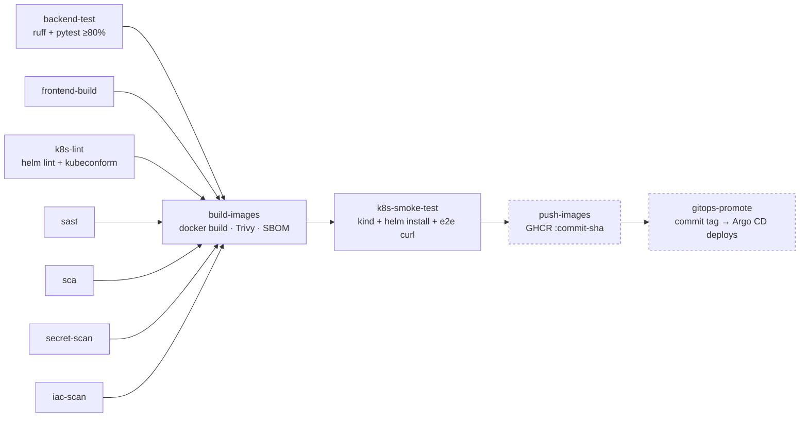

The dashed jobs run only on `main`. Pull requests go through the same tests, security scans, build, and smoke
test, but nothing gets published.

| Requirement | Implementation |
|---|---|
| Build | `frontend-build`, `build-images` (matrix: backend, frontend) |
| Test | `backend-test` (pytest, coverage gate), `k8s-lint`, `k8s-smoke-test` (real cluster, `helm test`, end-to-end request) |
| Docker build | `docker build` with `GIT_SHA` baked in (visible in the UI header and `/api/info`) |
| Image push | `push-images` pushes to `ghcr.io/<owner>/stockpilot-{backend,frontend}:<commit-sha>` (SHA tags only, never `latest`; optional amd64+arm64 build via repository variable `MULTI_ARCH=true`) |
| Kubernetes deployment | GitOps: `gitops-promote` commits the new tag and Argo CD syncs it. Push-based alternative: `deploy-helm.yml` (manual, OIDC to EKS, `helm upgrade --atomic`) |

The other workflows are `terraform.yml` (fmt, validate, Trivy IaC scan) and `security-nightly.yml`, which
re-scans the currently deployed images for newly published CVEs.

## 11. DevSecOps implementation

| Requirement | Tool | Gate |
|---|---|---|
| SAST | Semgrep (registry rules + 4 custom rules) and Bandit | Blocks on ERROR / medium+ findings |
| SCA | pip-audit, npm audit, Dependabot | Blocks on known CVEs |
| Secret scanning | Gitleaks over the full Git history (+ pre-commit hook) | Blocks on any secret |
| Container image scanning | Trivy | Blocks on fixable HIGH/CRITICAL CVEs |
| IaC scanning | Trivy config on Terraform, Helm, manifests, Dockerfiles | Blocks on CRITICAL |
| Security gates | `build-images` `needs:` every scan job | No image is built unless all gates pass |

**Container scan result.** Trivy compares the version of every OS package (Debian in the backend image, Alpine
in the frontend image) and every language dependency (Python wheels, npm packages) in the built image against
vulnerability databases; the CycloneDX SBOM attached to each run lists exactly what was scanned.
The gate fails on HIGH or CRITICAL CVEs that already have a fixed version; unfixed ones are reported, but an
upgrade cannot remediate them. A clean result means the image had no known, fixable high-severity
vulnerability at build time, which is why the nightly workflow re-scans as new CVEs are published.
The first pipeline run was clean: 0 fixable HIGH/CRITICAL CVEs in the backend image (Debian 13.7, 87 OS
packages plus the Python dependencies) and in the frontend image (Alpine 3.24.2, 70 OS packages).

The project also uses non-root containers, read-only root filesystems, dropped capabilities, NetworkPolicy,
Pod Security Admission, OIDC instead of AWS keys, least-privilege job permissions, actions pinned to commit
SHAs, and a CycloneDX SBOM per image. Secrets are never stored in Git, and accepted risks are documented in a
register (`security/.trivyignore`). More detail is in [`security/README.md`](security/README.md).

## 12. Monitoring

The backend exposes request count and latency per endpoint, plus a business metric
(`stockpilot_inventory_operations_total`). A ServiceMonitor makes Prometheus scrape it.

The dashboard, "StockPilot: Application", shows request rate, 5xx ratio, p95 latency, targets up, requests by
endpoint/status, latency percentiles, inventory operations, CPU per pod, replica count vs HPA, and a Loki logs panel.

Alerts cover the backend being down, an error rate above 5%, p95 latency above 500 ms, a pod restart loop, and
the HPA being maxed out.

The backend writes JSON logs, which Alloy ships to Loki. You can query them with something like
`{container="backend"} | json | status >= 400`.

```bash
kubectl port-forward -n monitoring svc/kube-prometheus-stack-grafana 3000:80
kubectl get secret grafana-admin -n monitoring -o jsonpath='{.data.admin-password}' | base64 -d

# Demo the HPA while watching the dashboard
./scripts/load-test.sh http://stockpilot.local 20 180
kubectl get hpa -n stockpilot -w
```

More detail is in [`monitoring/README.md`](monitoring/README.md).

## 13. GitOps

Git is the source of truth, and the cluster pulls its desired state from it.

1. A merge to `main` builds and pushes images tagged with the commit SHA.
2. CI commits that SHA into `gitops/environments/dev/values.yaml`.
3. Argo CD (installed by `scripts/bootstrap-cluster.sh`) sees the commit and syncs the Helm release.
4. `selfHeal` reverts manual `kubectl` changes, and `prune` deletes resources removed from Git.
5. A rollback is a `git revert`. Promotion to prod is a PR that copies the tag into `environments/prod`,
   followed by a manual sync.

The monitoring stack is also an Argo CD app (`gitops/apps/monitoring.yaml`), so the whole platform is in Git.

```bash
./scripts/bootstrap-cluster.sh            # Argo CD + project + root app
kubectl port-forward -n argocd svc/argocd-server 8081:80   # http://localhost:8081
```

More detail is in [`gitops/README.md`](gitops/README.md).

## 14. Troubleshooting

The final challenge is a set of 14 deliberately broken scenarios. Each one is solved with the same process:
identify, investigate, find the root cause, fix, verify, and document.

| Kubernetes (Kustomize overlays) | Pipeline / GitOps (`troubleshooting/pipeline/break.sh`) |
|---|---|
| 01 ImagePullBackOff · 02 CrashLoopBackOff (bad ConfigMap) · 03 missing Secret key · 04 Service selector mismatch · 05 failing readiness probe · 06 OOMKilled · 07 PVC Pending · 08 HPA `<unknown>` · 09 Ingress wrong port · 10 NetworkPolicy blocking DB | 11 failing unit test · 12 vulnerable dependency · 13 leaked secret · 14 bad GitOps image tag |

```bash
make raw-deploy                               # healthy baseline
make break S=04-service-selector              # introduce a fault
./troubleshooting/diagnose.sh stockpilot-raw  # collect evidence into a report
```

- Scenarios: [`troubleshooting/README.md`](troubleshooting/README.md)
- Six-step write-up for every scenario: [`docs/TROUBLESHOOTING-LOG.md`](docs/TROUBLESHOOTING-LOG.md)

Quick reference:

```bash
kubectl get pods -n <ns> -o wide                 # status at a glance
kubectl describe pod <pod> -n <ns>               # events: scheduling, image pulls, probe failures, OOM
kubectl logs <pod> -n <ns> -c <container> [--previous]
kubectl get events -n <ns> --sort-by=.lastTimestamp
kubectl get endpoints <svc> -n <ns>              # empty = selector matches no Ready pod
kubectl describe hpa|pvc|ingress <name> -n <ns>
kubectl top pods -n <ns>
```

## 15. Screenshots

### Local run (Docker Compose)

| | |
|---|---|
| Application | 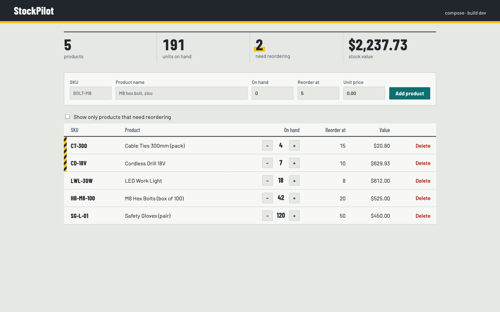 |
| API (Swagger UI) | 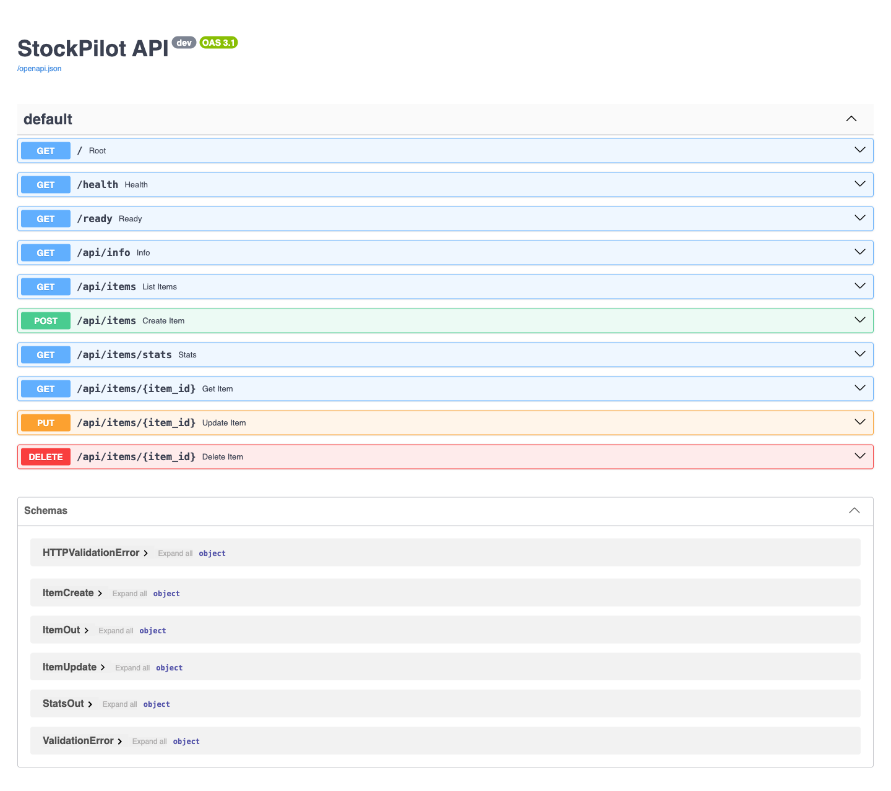 |
| Tests (`pytest -v`) | 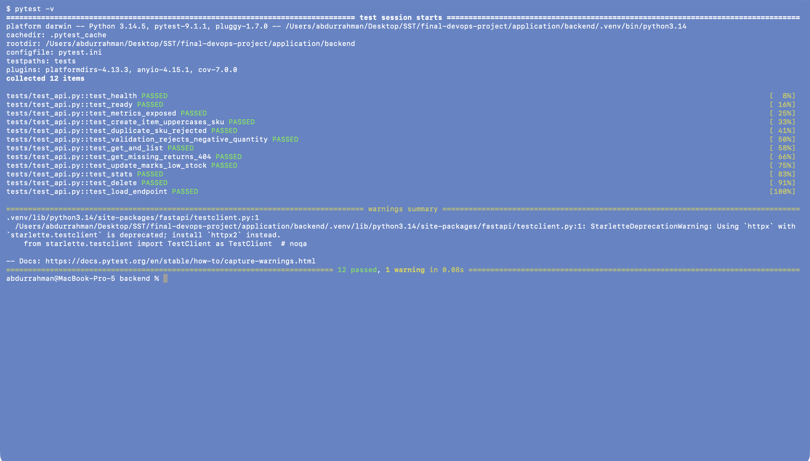 |
| `docker compose up --build` | 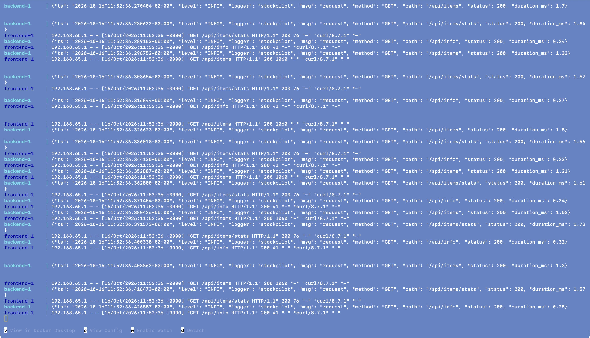 |
| All services running | 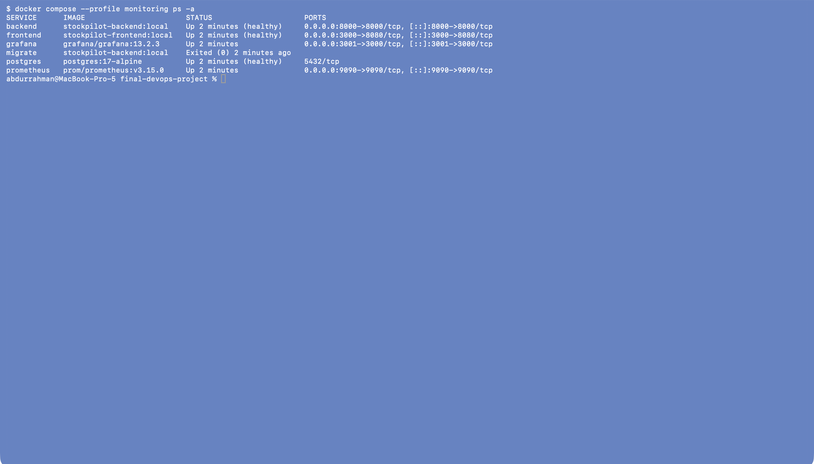 |
| Backend `/metrics` | 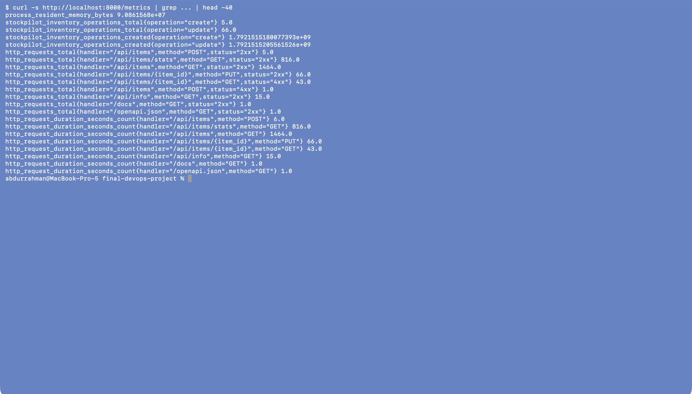 |
| Prometheus target UP | 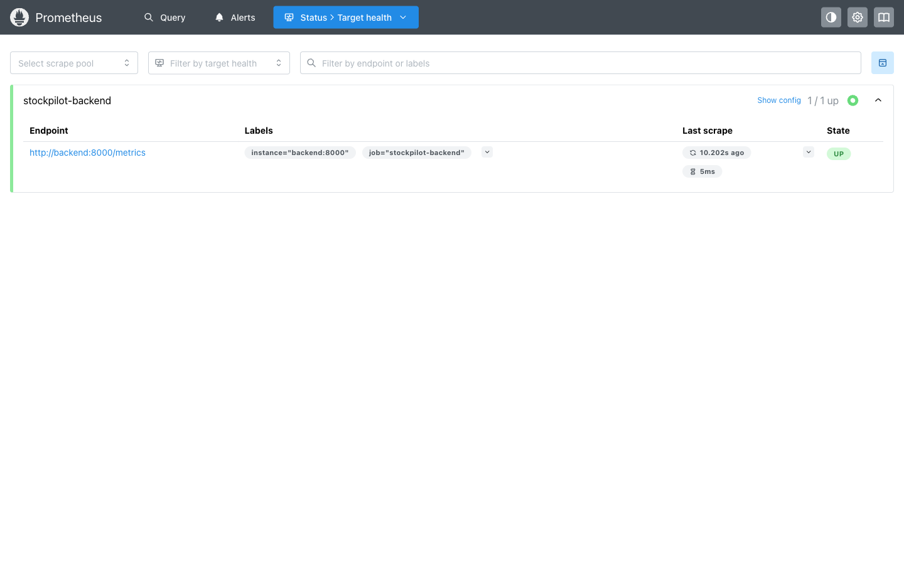 |
| Grafana dashboard | 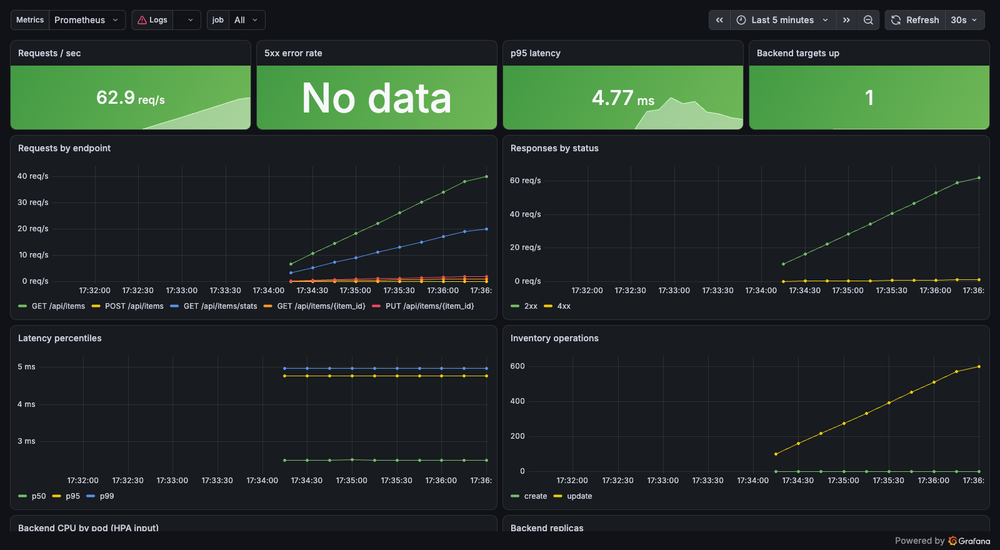 |

### CI/CD, security and registry

| | |
|---|---|
| Commit history | 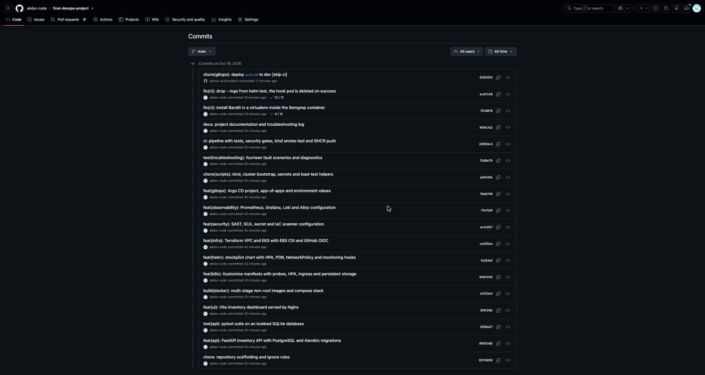 |
| Green pipeline | 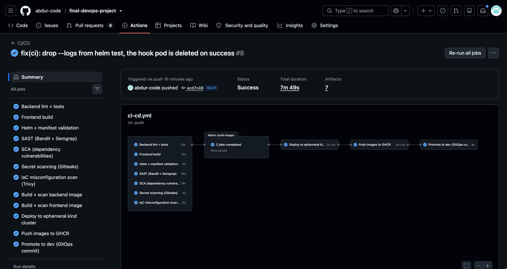 |
| Trivy scan, backend image | 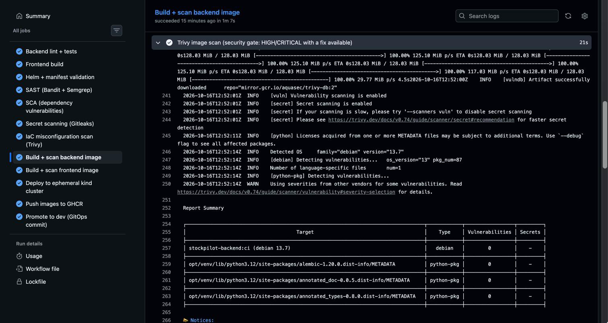 |
| Trivy scan, frontend image | 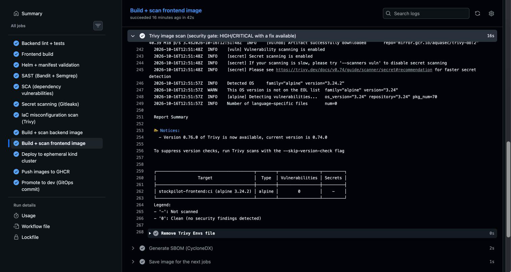 |
| Images in GHCR, tagged with the commit SHA | 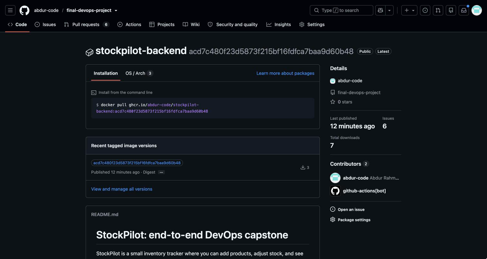 |
| Security gate blocking a vulnerable dependency (PR #7) |  |
| pip-audit findings that failed the SCA gate |  |

## 16. Lessons learned

- **Gates only work if they are wired in.** Scans that merely report are ignored. `needs:` makes the image
  build impossible until tests and every scanner pass.
- **Test the tests.** A custom Semgrep rule looked fine but produced false positives on correct Dockerfiles, and a
  break script silently failed (`/dev/urandom | head` + `pipefail` = SIGPIPE exit). Both were only caught by running
  them against known-good and known-bad input.
- **Pin by digest/SHA, not by tag.** Tags are mutable; `trivy-action` tags were re-published in March 2026.
  Images are deployed by commit SHA for the same reason: every running pod traces back to one commit.
- **Liveness ≠ readiness.** `/health` must not touch the database, or a DB blip restarts every pod at once.
- **HPA needs resource requests** and a metrics source; without them targets show `<unknown>`.
- **Don't set `replicas` when an HPA owns them**, or Helm/Argo CD and the autoscaler fight on every sync.
- **Secrets never belong in Git**, not even "dev" ones; history is forever. Generate them in the cluster.
- **GitOps changes how you operate:** rollbacks are `git revert`, and `kubectl edit` gets undone by self-heal.
- **StatefulSet volume templates are immutable**; storage mistakes are expensive to fix later.
- **Cost is a DevOps concern.** A NAT gateway and an idle EKS cluster cost money every hour; `terraform destroy` is part of the workflow.
