# Troubleshooting log

These are fourteen faults I introduced on purpose. Each one goes through the same six steps: identify, investigate, root cause, fix, verify, document. The documenting step is the entry itself plus a screenshot, and it ends with a "Prevention" note.
Scenarios 01-10 run on namespace `stockpilot-raw` (`make break S=<scenario>`); 11-14 use `troubleshooting/pipeline/break.sh`.
I collect the raw command output for each run with `troubleshooting/diagnose.sh`, and the reports are kept in `troubleshooting/reports/`.

| # | Fault | Category | Detected by |
|---|---|---|---|
| 01 | ImagePullBackOff | Kubernetes | pod status / events |
| 02 | CrashLoopBackOff from a ConfigMap typo | Kubernetes | container logs |
| 03 | CreateContainerConfigError (wrong Secret key) | Kubernetes | pod events |
| 04 | Service selector mismatch (no endpoints) | Kubernetes | empty endpoints |
| 05 | Readiness probe on a wrong path | Kubernetes | probe events |
| 06 | OOMKilled | Kubernetes | pod last state |
| 07 | PersistentVolumeClaim stuck in Pending | Kubernetes | PVC events |
| 08 | HPA targets show <unknown> | Kubernetes | HPA describe |
| 09 | Ingress routes /api to the wrong port | Kubernetes | Ingress describe / controller logs |
| 10 | NetworkPolicy blocks the database | Kubernetes | init container logs |
| 11 | Failing unit test blocks the pipeline | CI/CD | CI test job |
| 12 | Vulnerable dependency stops the build | CI/CD | CI SCA job |
| 13 | Leaked secret detected | CI/CD | CI secret scan |
| 14 | Bad image tag through GitOps | CI/CD | Argo CD health |

## 01. ImagePullBackOff

Scenario: `01-image-pull`

### 1. Identify
New backend pods never start. `kubectl get pods` shows `Init:ErrImagePull` and then `Init:ImagePullBackOff`. The old ReplicaSet keeps serving because the rollout uses `maxUnavailable: 0`.

### 2. Investigate
```bash
kubectl get pods -n stockpilot-raw
kubectl describe pod <backend-pod> -n stockpilot-raw   # Events: Failed to pull image ".../stockpilot-backend:v9.9.9-hotfix": not found
```

### 3. Root cause
The Deployment points at a tag that was never built. CI only publishes immutable commit-SHA tags, so `v9.9.9-hotfix` does not exist in GHCR. The init container uses the same image and fails first, which is why the status has the `Init:` prefix.

### 4. Fix
Put back the tag CI wrote with `kubectl apply -k kubernetes/`. The Kustomize `images:` block holds the SHA.

### 5. Verify
```bash
kubectl rollout status deploy/backend -n stockpilot-raw
kubectl get pods -n stockpilot-raw    # all Running, READY 1/1
```

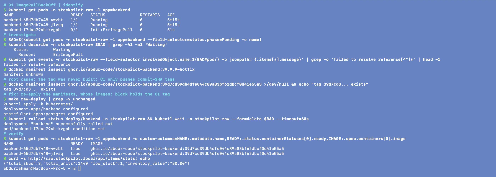

### 6. Prevention
Only CI picks tags (the gitops-promote job). The Helm chart will not render without an explicit tag, so `latest` or a tag typed by hand can't get in.

## 02. CrashLoopBackOff from a ConfigMap typo

Scenario: `02-crashloop-config`

### 1. Identify
Backend pods keep restarting with `Init:CrashLoopBackOff`, and the UI says the API is unreachable.

### 2. Investigate
```bash
kubectl logs <backend-pod> -c migrate -n stockpilot-raw   # name-resolution error for host 'postgress', 'database not ready, retrying'
kubectl get configmap stockpilot-config -n stockpilot-raw -o yaml
kubectl get svc -n stockpilot-raw   # the Service is called 'postgres'
```

### 3. Root cause
`DB_HOST` in the ConfigMap is `postgress`. No Service has that name, so DNS resolution fails and the migration container exits once it runs out of retries.

### 4. Fix
Restore the ConfigMap (`kubectl apply -k kubernetes/`), then restart the pods with `kubectl rollout restart deploy/backend -n stockpilot-raw`. The restart is needed because environment variables from a ConfigMap are only read when the container starts.

### 5. Verify
```bash
kubectl exec deploy/backend -n stockpilot-raw -- printenv DB_HOST   # postgres
kubectl get pods -n stockpilot-raw
```

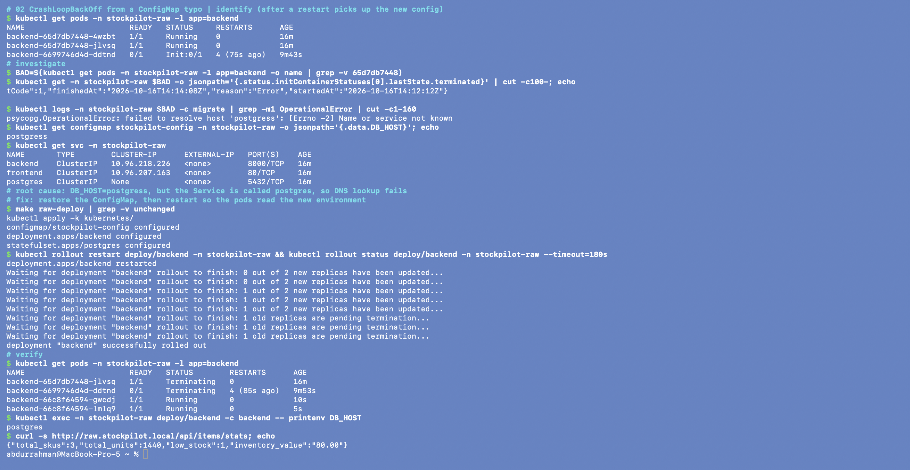

### 6. Prevention
The Helm chart builds `DB_HOST` from the release name. It also adds a `checksum/config` annotation, so the pods roll on their own when the configuration changes.

## 03. CreateContainerConfigError (wrong Secret key)

Scenario: `03-secret-key`

### 1. Identify
The PostgreSQL pod never starts and its status is `CreateContainerConfigError`. Backend pods sit waiting in their init container.

### 2. Investigate
```bash
kubectl describe pod postgres-0 -n stockpilot-raw   # couldn't find key DB_PASS in Secret stockpilot-raw/stockpilot-db
kubectl get secret stockpilot-db -n stockpilot-raw -o jsonpath='{.data}'   # keys: DB_USER, DB_PASSWORD
```

### 3. Root cause
`secretKeyRef.key` is set to `DB_PASS`, but the key in the Secret is `DB_PASSWORD`. Kubernetes won't create a container if a key it references is missing.

### 4. Fix
Change the reference back to `DB_PASSWORD` (`kubectl apply -k kubernetes/`).

### 5. Verify
```bash
kubectl get pods -n stockpilot-raw   # postgres-0 1/1 Running, backend becomes Ready
```

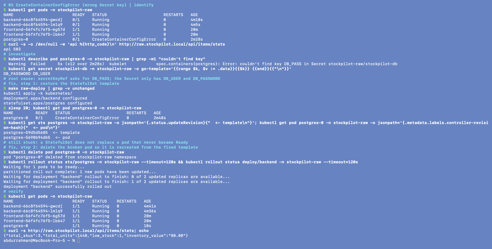

### 6. Prevention
The raw manifests and the chart both use one Secret with fixed key names. `helm lint` and the CI smoke test check them on every change.

## 04. Service selector mismatch (no endpoints)

Scenario: `04-service-selector`

### 1. Identify
The UI loads but shows "Can't reach the inventory API". Every `/api` request fails even though all pods are Running and Ready.

### 2. Investigate
```bash
kubectl get endpoints backend -n stockpilot-raw    # ENDPOINTS <none>
kubectl get pods -n stockpilot-raw --show-labels   # pods carry app=backend
kubectl get svc backend -n stockpilot-raw -o jsonpath='{.spec.selector}'   # {"app":"back-end"}
```

### 3. Root cause
The Service selects `app=back-end` and the pods are labelled `app=backend`. A selector that matches nothing gives an empty endpoint list, so the traffic has nowhere to go.

### 4. Fix
Set the selector back to `app: backend` (`kubectl apply -k kubernetes/`).

### 5. Verify
```bash
kubectl get endpoints backend -n stockpilot-raw   # pod IPs listed
curl -s http://raw.stockpilot.local/api/items/stats
```

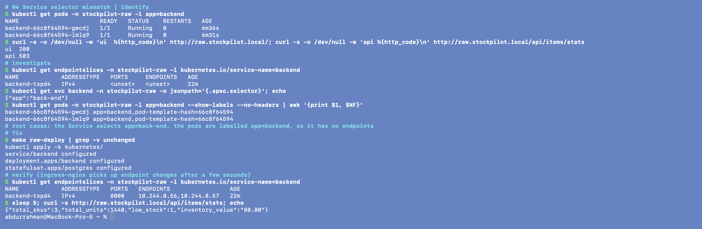

### 6. Prevention
In the Helm chart, labels and selectors come from one helper template, so they can't drift apart.

## 05. Readiness probe on a wrong path

Scenario: `05-readiness-probe`

### 1. Identify
New pods are `Running` but `0/1` READY, and `kubectl rollout status` never finishes.

### 2. Investigate
```bash
kubectl describe pod <new-backend-pod> -n stockpilot-raw   # Readiness probe failed: HTTP probe failed with statuscode: 404
kubectl get deploy backend -n stockpilot-raw -o jsonpath='{.spec.template.spec.containers[0].readinessProbe}'
```

### 3. Root cause
The readiness probe calls `/readyz`, but the app serves `/ready`. A failing readiness probe doesn't restart the pod. It keeps the pod out of the Service, so the rollout stalls and the old pods keep serving.

### 4. Fix
Change the probe path back to `/ready` (`kubectl apply -k kubernetes/`).

### 5. Verify
```bash
kubectl rollout status deploy/backend -n stockpilot-raw   # successfully rolled out
```

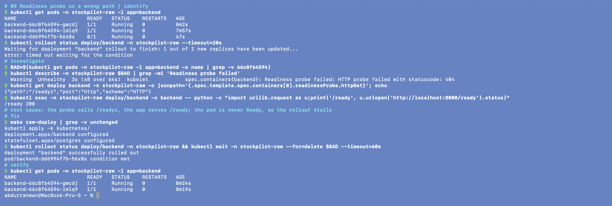

### 6. Prevention
The CI smoke test installs the chart with `--wait`, and the pipeline fails if the pods never become Ready.

## 06. OOMKilled

Scenario: `06-oomkilled`

### 1. Identify
The backend restarts every few seconds and the restart count keeps going up.

### 2. Investigate
```bash
kubectl describe pod <backend-pod> -n stockpilot-raw   # Last State: Terminated, Reason: OOMKilled, Exit Code: 137
kubectl top pods -n stockpilot-raw
```

### 3. Root cause
The memory limit is 24Mi, and Python + FastAPI + SQLAlchemy need roughly 60-90Mi. When the process goes over the cgroup limit the kernel kills it (exit code 137 = SIGKILL).

### 4. Fix
Set the limit back to 256Mi (`kubectl apply -k kubernetes/`).

### 5. Verify
```bash
kubectl get pods -n stockpilot-raw   # restarts stop increasing
kubectl top pods -n stockpilot-raw
```

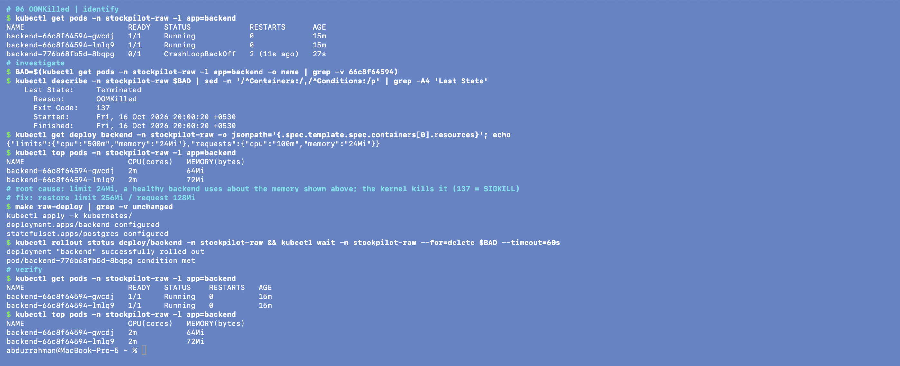

### 6. Prevention
Set limits from observed usage, which the Grafana CPU/memory panels show. The `StockPilotPodRestarting` alert fires on restart loops.

## 07. PersistentVolumeClaim stuck in Pending

Scenario: `07-pvc-pending`

### 1. Identify
The PostgreSQL pod is stuck in `Pending` and the backend never becomes Ready.

### 2. Investigate
```bash
kubectl get pvc -n stockpilot-raw   # data-postgres-0 Pending
kubectl describe pvc data-postgres-0 -n stockpilot-raw   # storageclass.storage.k8s.io "premium-ssd" not found
kubectl get storageclass
```

### 3. Root cause
The StatefulSet's `volumeClaimTemplates` ask for StorageClass `premium-ssd`, which doesn't exist. No volume can be provisioned, so the pod can't be scheduled.

### 4. Fix
`volumeClaimTemplates` are immutable and `kubectl apply` gets rejected, so I recreate the StatefulSet and its PVC:
`kubectl delete sts postgres -n stockpilot-raw && kubectl delete pvc data-postgres-0 -n stockpilot-raw && kubectl apply -k kubernetes/`

### 5. Verify
```bash
kubectl get pvc -n stockpilot-raw   # Bound
kubectl get pods -n stockpilot-raw   # postgres-0 Running
```

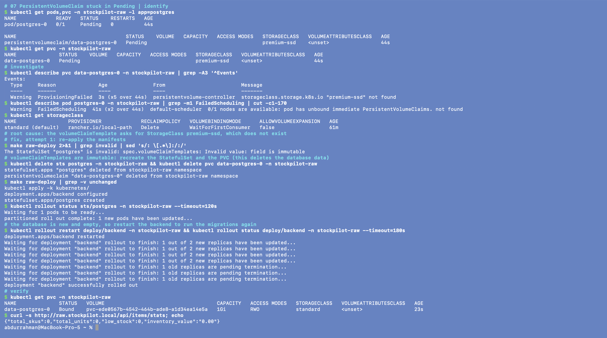

### 6. Prevention
The storage class is one chart value per environment. Deleting a PVC deletes its data, so the storage settings should be checked before the first deploy.

## 08. HPA targets show <unknown>

Scenario: `08-hpa-unknown`

### 1. Identify
`kubectl get hpa` shows `cpu: <unknown>/60%`, and the backend never scales under load.

### 2. Investigate
```bash
kubectl describe hpa backend -n stockpilot-raw   # failed to get cpu utilization: missing request for cpu
kubectl top pods -n stockpilot-raw   # metrics-server works, so the metrics source is fine
```

### 3. Root cause
The HPA computes utilisation as usage divided by the container's CPU request. The Deployment has no `resources.requests`, so there is nothing to compute a percentage from.

### 4. Fix
Restore the resource block (`kubectl apply -k kubernetes/`).

### 5. Verify
```bash
./scripts/load-test.sh http://raw.stockpilot.local 20 180
kubectl get hpa backend -n stockpilot-raw -w   # cpu climbs above 60%, REPLICAS increases
```

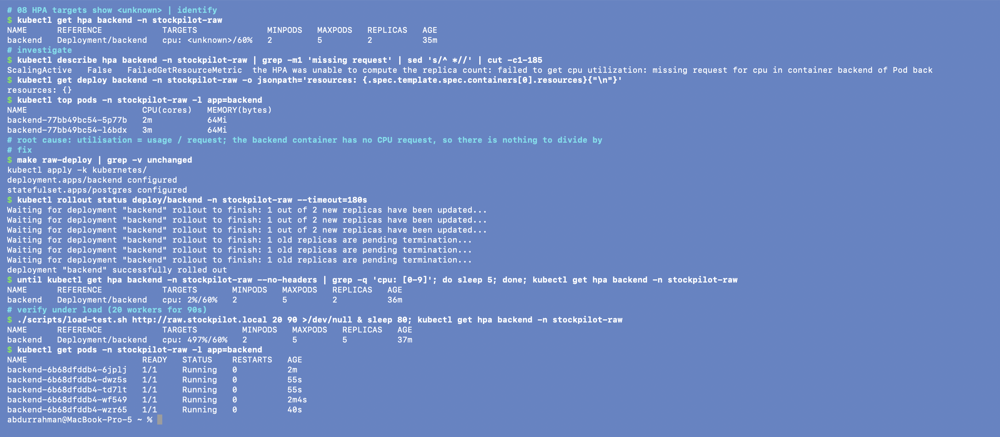

### 6. Prevention
The chart always sets requests (a comment in `values.yaml` says why), and `helm lint` runs in CI.

## 09. Ingress routes /api to the wrong port

Scenario: `09-ingress-port`

### 1. Identify
`http://raw.stockpilot.local/` loads, but every `/api/...` request gets a 503.

### 2. Investigate
```bash
kubectl describe ingress stockpilot -n stockpilot-raw   # backend backend:8080
kubectl get svc backend -n stockpilot-raw   # PORT(S) 8000/TCP
kubectl logs -n ingress-nginx deploy/ingress-nginx-controller | tail
```

### 3. Root cause
The Ingress sends `/api` traffic to Service port 8080. The Service only listens on 8000, so the controller has no upstream to send it to.

### 4. Fix
Change the port back to 8000 (`kubectl apply -k kubernetes/`).

### 5. Verify
```bash
curl -s -o /dev/null -w '%{http_code}\n' http://raw.stockpilot.local/api/items   # 200
```

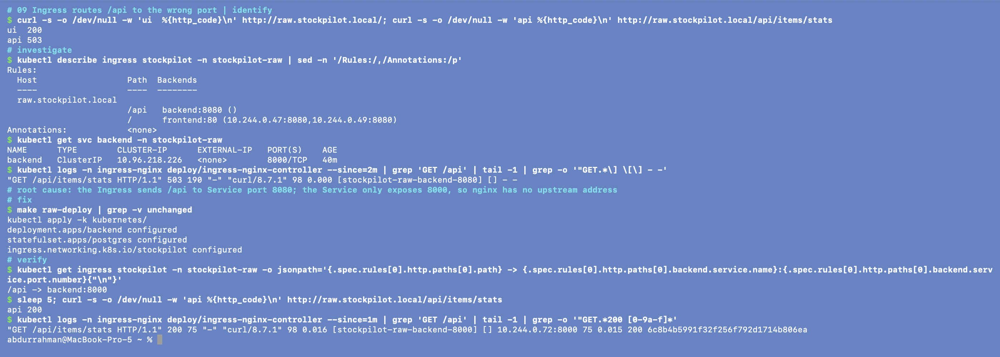

### 6. Prevention
The Helm chart refers to ports by name (`http`) instead of by number, so this kind of mistake can't happen there.

## 10. NetworkPolicy blocks the database

Scenario: `10-networkpolicy`

### 1. Identify
Backend pods stay at `0/1` and the migrate init container keeps looping on connection timeouts. This only shows up with a CNI that enforces NetworkPolicy, such as kindnet in current kind or the EKS VPC CNI with policy enabled.

### 2. Investigate
```bash
kubectl logs <backend-pod> -c migrate -n stockpilot-raw   # connection to postgres:5432 timed out
kubectl get networkpolicy -n stockpilot-raw -o yaml   # ingress allowed from app: api
kubectl exec deploy/frontend -n stockpilot-raw -- wget -T 3 -qO- postgres:5432   # also times out
```

### 3. Root cause
The policy only lets in pods labelled `app: api`, and no pod has that label, so the backend's traffic to PostgreSQL gets dropped without any error. The clue is that the connection times out instead of being refused, which points to packets being dropped by policy.

### 4. Fix
Allow `app: backend` again (`kubectl apply -k kubernetes/`).

### 5. Verify
```bash
kubectl exec deploy/backend -n stockpilot-raw -c backend -- python -c "import socket;socket.create_connection(('postgres',5432),3);print('ok')"
```

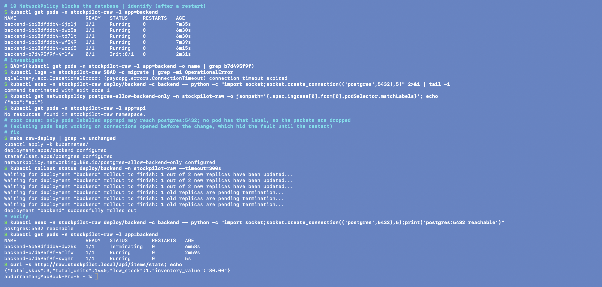

### 6. Prevention
The chart builds the policy from the same selector helper the backend Deployment uses.

## 11. Failing unit test blocks the pipeline

Scenario: `pipeline: failing-test`

### 1. Identify
The PR's GitHub Actions run goes red at *Backend lint + tests*. Every job after it is *skipped*, so no image gets built.

### 2. Investigate
```bash
Actions → run → Backend lint + tests → `test_create_item_uppercases_sku`: `'bolt-m8' != 'BOLT-M8'` (3 tests fail)
git show HEAD   # the commit removed item.sku.upper()
```

### 3. Root cause
The commit removed SKU normalisation, which changed API behaviour that the tests define.

### 4. Fix
Revert the change (`git revert HEAD`) and push.

### 5. Verify
```bash
The pipeline run on the branch turns green.
```

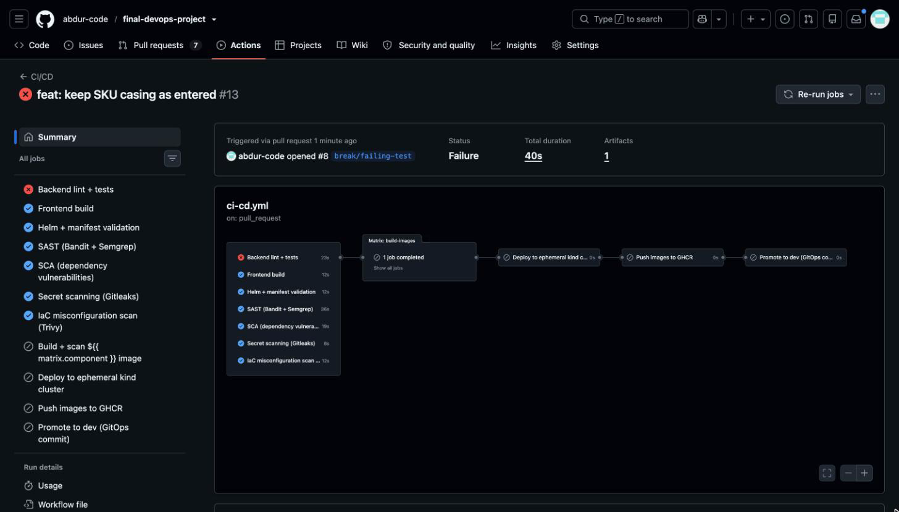

### 6. Prevention
`needs:` makes the tests a hard gate before any image is built or pushed.

## 12. Vulnerable dependency stops the build

Scenario: `pipeline: vulnerable-dep`

### 1. Identify
PR #7 (CI/CD run #10): tests, SAST, secret scanning and the IaC scan pass, but the *SCA* job fails after 17s.
The build, kind deploy, GHCR push and GitOps promote jobs are skipped, so no image was built.

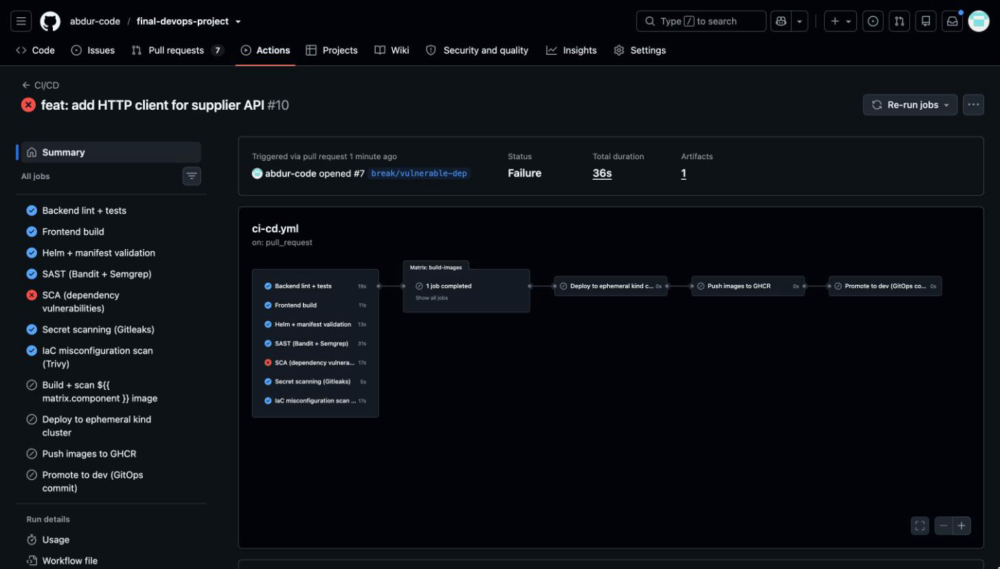

### 2. Investigate
The pip-audit step of the SCA job:
```
Found 6 known vulnerabilities in 1 package
requests 2.31.0  PYSEC-2026-1873  fixed in 2.32.0  TLS verification can stay off on a reused Session connection
requests 2.31.0  PYSEC-2026-1872  fixed in 2.32.4  .netrc credentials can leak for crafted URLs
requests 2.31.0  PYSEC-2026-2275  fixed in 2.33.0  predictable temp file in extract_zipped_paths()
```

### 3. Root cause
The new dependency is pinned to a version with published CVEs.

### 4. Fix
I closed PR #7 without merging and deleted the branch, so the dependency never reached `main`. If the
library were really needed, the fix is to pin `requests>=2.33.0`, the highest fixed version pip-audit reports.

### 5. Verify
`main` stays green: the last push to `main` passed every gate, including pip-audit and the Trivy image scans.

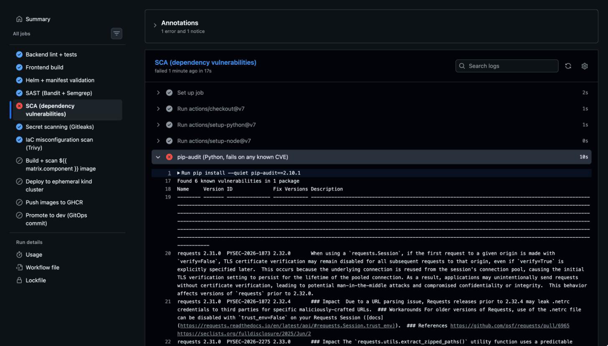

### 6. Prevention
Dependabot opens upgrade PRs every week, and the nightly workflow re-scans the deployed images for newly published CVEs.

## 13. Leaked secret detected

Scenario: `pipeline: leaked-secret`

### 1. Identify
The *Secret scanning (Gitleaks)* job fails.

### 2. Investigate
```bash
Actions → Secret scanning → `RuleID: github-pat`, file `application/backend/app/supplier.py` (value redacted)
```

### 3. Root cause
A credential that looks like a token was committed to the source code.

### 4. Fix
Deleting the file in a new commit isn't enough, because the secret is still in the history. What I do instead: 1) Revoke or rotate the token. 2) Remove the commit before merging (`git reset --hard HEAD~1` on the branch, then `git push --force-with-lease`). 3) Read credentials from environment variables or Kubernetes Secrets.

### 5. Verify
```bash
Gitleaks job green; `git log -p` on the branch no longer contains the token.
```

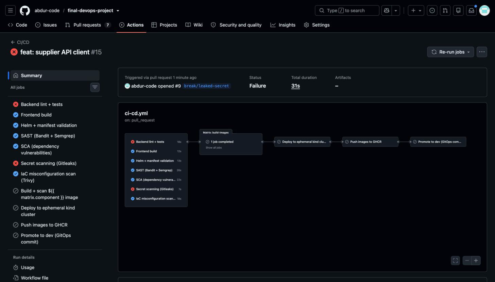

### 6. Prevention
The pre-commit hook runs Gitleaks before each commit, and CI scans the full history (`fetch-depth: 0`).

## 14. Bad image tag through GitOps

Scenario: `pipeline: bad-gitops-tag`

### 1. Identify
After the merge, Argo CD shows `stockpilot-dev` as *Degraded*. New backend pods are in `ImagePullBackOff` and the old ones keep serving.

### 2. Investigate
```bash
Argo CD UI → stockpilot-dev → backend pod → Events: image not found
git log -1 -- gitops/environments/dev/values.yaml   # the commit that set tag 0000000-does-not-exist
```

### 3. Root cause
Git is the source of truth, and it now declares an image that doesn't exist. Argo CD applies it exactly as written.

### 4. Fix
Run `git revert <commit> && git push`, and Argo CD syncs back within a minute. A fix made with `kubectl` would just be undone by self-heal.

### 5. Verify
```bash
Argo CD app Synced/Healthy; `kubectl get pods -n stockpilot` all Ready.
```

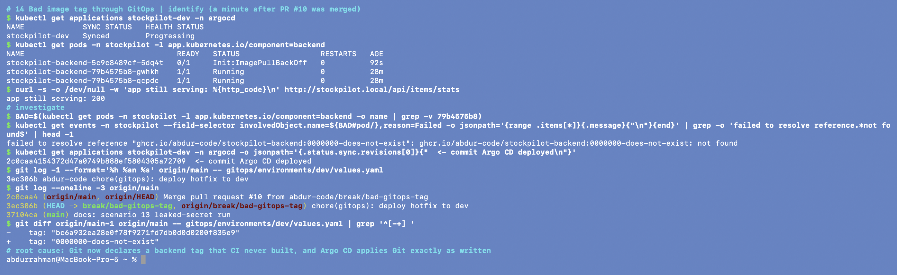

### 6. Prevention
Only CI writes image tags, and it only uses SHAs it has just pushed. With GitOps a rollback is a `git revert`, and the Git history doubles as the audit log.
