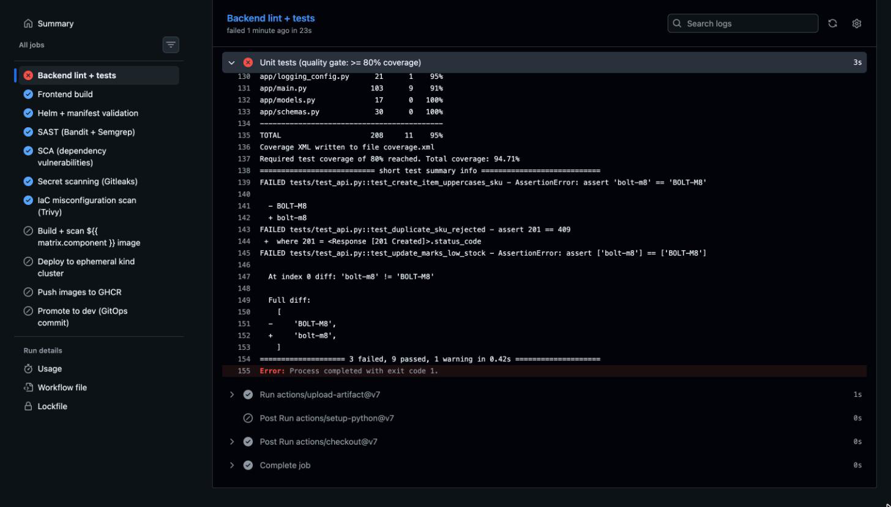
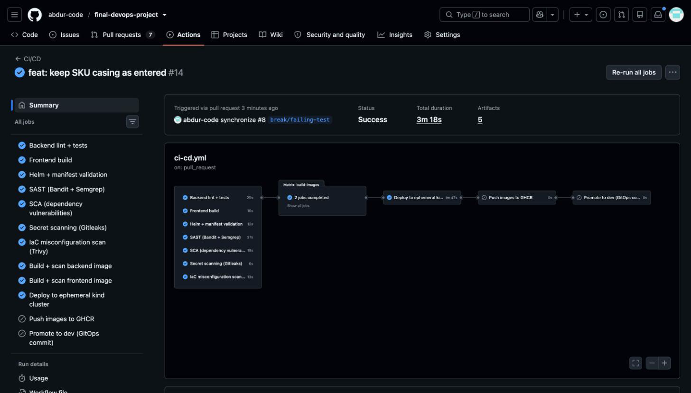
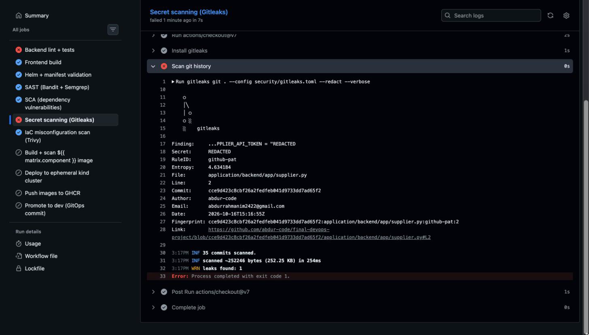
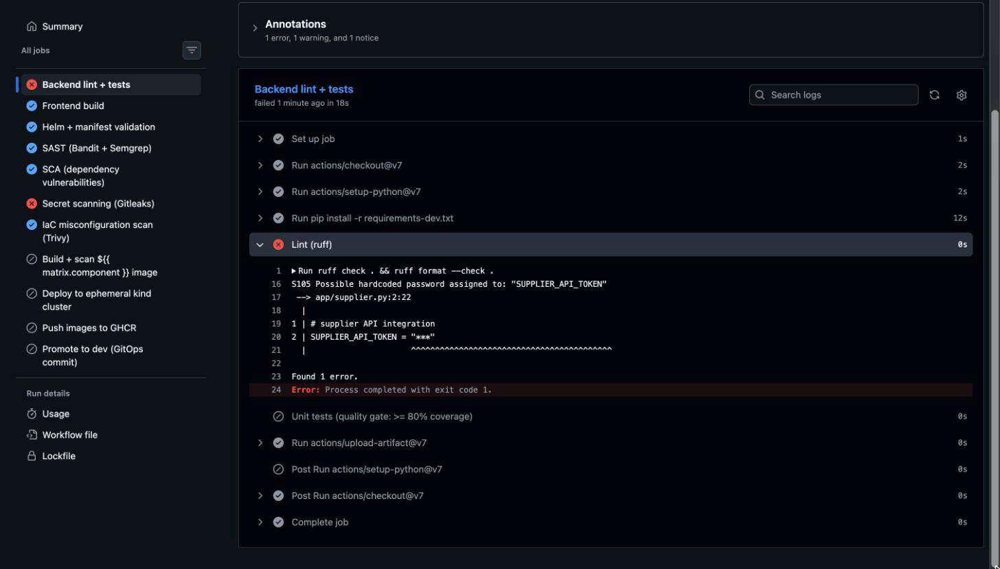
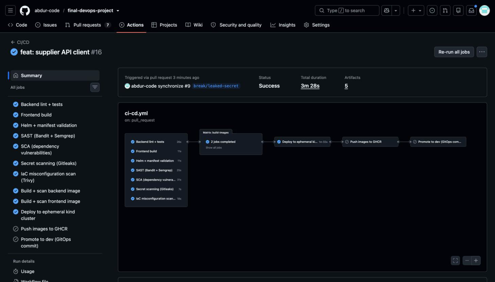

# Troubleshooting log

I broke the project fourteen times on purpose and fixed it each time. Every entry follows the steps from the brief (identify, investigate, root cause, fix, verify) and ends with a note on how to stop it happening again.
Scenarios 01-10 ran on my local kind cluster in the `stockpilot-raw` namespace (`make break S=<scenario>`). 11-14 go through GitHub and use `troubleshooting/pipeline/break.sh`.
The output in each entry is pasted from the actual run, cut down to the lines that matter. The screenshot under it shows the whole terminal session, from the first `kubectl get pods` to the final check.
If you don't know where to start, `troubleshooting/diagnose.sh` dumps pods, events, describe output and logs for a namespace into one report.

| # | Fault | Category | Detected by |
|---|---|---|---|
| 01 | ImagePullBackOff | Kubernetes | pod status / events |
| 02 | CrashLoopBackOff from a ConfigMap typo | Kubernetes | container logs |
| 03 | CreateContainerConfigError (wrong Secret key) | Kubernetes | pod events |
| 04 | Service selector mismatch (no endpoints) | Kubernetes | empty endpoints |
| 05 | Readiness probe on a wrong path | Kubernetes | probe events |
| 06 | OOMKilled | Kubernetes | pod last state |
| 07 | PersistentVolumeClaim stuck in Pending | Kubernetes | PVC events |
| 08 | HPA targets show <unknown> | Kubernetes | HPA describe |
| 09 | Ingress routes /api to the wrong port | Kubernetes | Ingress describe / controller logs |
| 10 | NetworkPolicy blocks the database | Kubernetes | init container logs |
| 11 | Failing unit test blocks the pipeline | CI/CD | CI test job |
| 12 | Vulnerable dependency stops the build | CI/CD | CI SCA job |
| 13 | Leaked secret detected | CI/CD | CI secret scan |
| 14 | Bad image tag through GitOps | CI/CD | Argo CD health |

## 01. ImagePullBackOff

Scenario: `01-image-pull`

### 1. Identify
A new backend pod showed up and never started. It went from `Init:ErrImagePull` to `Init:ImagePullBackOff`. Users wouldn't have noticed: the rollout uses `maxUnavailable: 0`, so the two old pods stayed `1/1 Running` and the API kept answering.

### 2. Investigate
```
$ kubectl get pods -n stockpilot-raw -l app=backend
backend-65d7db7448-4wzbt   1/1   Running                 0   2m25s
backend-65d7db7448-jlvsq   1/1   Running                 0   2m25s
backend-f7d4c794b-ttjxs    0/1   Init:ImagePullBackOff   0   67s

$ kubectl get events -n stockpilot-raw
Failed to pull image "ghcr.io/abdur-code/stockpilot-backend:v9.9.9-hotfix": rpc error: code = NotFound
  ... failed to resolve reference "ghcr.io/abdur-code/stockpilot-backend:v9.9.9-hotfix": not found

$ docker manifest inspect ghcr.io/abdur-code/stockpilot-backend:v9.9.9-hotfix
manifest unknown
```

### 3. Root cause
The Deployment asks for `v9.9.9-hotfix`, and nobody ever built that tag. CI only pushes commit-SHA tags. `docker manifest inspect` confirmed it: GHCR has `39d7cd3...` but not `v9.9.9-hotfix`. The status starts with `Init:` because the `migrate` init container uses the same image and is the first thing to fail.

### 4. Fix
`make raw-deploy` (`kubectl apply -k kubernetes/`) puts the CI tag from the Kustomize `images:` block back. The Deployment went back to the old ReplicaSet and the broken pod was removed.

### 5. Verify
```
$ kubectl get pods -n stockpilot-raw -l app=backend -o custom-columns=NAME:...,READY:...,IMAGE:...
backend-65d7db7448-4wzbt   true   ghcr.io/abdur-code/stockpilot-backend:39d7cd39db4dfe044c89a83bf62dbcf0d41e55a5
backend-65d7db7448-jlvsq   true   ghcr.io/abdur-code/stockpilot-backend:39d7cd39db4dfe044c89a83bf62dbcf0d41e55a5

$ curl -s http://raw.stockpilot.local/api/items/stats
{"total_skus":3,"total_units":1440,"low_stock":1,"inventory_value":"80.00"}
```


### 6. Prevention
Tags come from CI (the gitops-promote job) and nowhere else. The Helm chart refuses to render without an explicit tag, which keeps `latest` and hand-typed tags out.

## 02. CrashLoopBackOff from a ConfigMap typo

Scenario: `02-crashloop-config`

### 1. Identify
At first nothing happened when I applied the broken ConfigMap. A container reads ConfigMap values into its environment once, when it starts, so the running pods still had `DB_HOST=postgres`. The problem appeared on the next restart (`kubectl rollout restart deploy/backend`). The new pod's `migrate` init container failed 4 times in 10 minutes while the old pods carried on serving.

### 2. Investigate
```
$ kubectl get pods -n stockpilot-raw -l app=backend
backend-6699746d4d-ddtnd   0/1   Init:0/1   4 (75s ago)   9m43s

$ kubectl logs <pod> -c migrate -n stockpilot-raw
psycopg.OperationalError: failed to resolve host 'postgress': [Errno -2] Name or service not known

$ kubectl get configmap stockpilot-config -n stockpilot-raw -o jsonpath='{.data.DB_HOST}'
postgress
$ kubectl get svc -n stockpilot-raw
backend    ClusterIP   10.96.218.226   8000/TCP
frontend   ClusterIP   10.96.207.163   80/TCP
postgres   ClusterIP   None            5432/TCP
```
The init container retries `alembic upgrade head` 30 times with 3 seconds between tries, so one failed attempt takes about 2 minutes. While I watched, the status kept switching between `Init:0/1`, `Init:Error` and `Init:CrashLoopBackOff`.

### 3. Root cause
Someone typed `postgress` for `DB_HOST`. There's no Service by that name, so the DNS lookup fails and the migration gives up after its retries.

### 4. Fix
Restore the ConfigMap with `make raw-deploy` and then run `kubectl rollout restart deploy/backend -n stockpilot-raw`. Skip the restart and the pods keep whatever environment they started with, even after the ConfigMap is fixed.

### 5. Verify
```
$ kubectl exec -n stockpilot-raw deploy/backend -c backend -- printenv DB_HOST
postgres
$ curl -s http://raw.stockpilot.local/api/items/stats
{"total_skus":3,"total_units":1440,"low_stock":1,"inventory_value":"80.00"}
```


### 6. Prevention
In the Helm chart `DB_HOST` is built from the release name. The backend pods also carry a `checksum/config` annotation, so changing the config rolls them automatically and a bad value fails straight away instead of on some later restart.

## 03. CreateContainerConfigError (wrong Secret key)

Scenario: `03-secret-key`

### 1. Identify
`postgres-0` got stuck in `CreateContainerConfigError`. With no database, `/ready` failed on both backend pods, they dropped to `0/1`, and the API returned 503 through the Ingress.

### 2. Investigate
```
$ kubectl describe pod postgres-0 -n stockpilot-raw
Warning  Failed  5s (x12 over 2m28s)  kubelet  Error: couldn't find key DB_PASS in Secret stockpilot-raw/stockpilot-db

$ kubectl get secret stockpilot-db -n stockpilot-raw -o go-template='{{range $k, $v := .data}}{{$k}} {{end}}'
DB_PASSWORD DB_USER
```

### 3. Root cause
The StatefulSet asks the Secret for a key called `DB_PASS`. The Secret only has `DB_PASSWORD` and `DB_USER`, and Kubernetes won't create a container whose env refers to a key that isn't there.

### 4. Fix
I expected `make raw-deploy` to be enough. It wasn't. Twenty seconds later the pod was still in `CreateContainerConfigError`, and the revision hashes showed why:
```
$ kubectl get sts postgres -o jsonpath='{.status.updateRevision}'                       postgres-59d5d5685   <- template
$ kubectl get pod postgres-0 -o jsonpath='{.metadata.labels.controller-revision-hash}'   postgres-5698b94db5  <- pod
```
The StatefulSet had the fixed template, but the pod was still on the broken one. A StatefulSet won't replace a pod that never became Ready, even once the template is fixed (the Kubernetes docs cover this under "Forced rollback"). Deleting the pod made it come back from the fixed template:
`kubectl delete pod postgres-0 -n stockpilot-raw`. The data lives on the PVC, so the delete cost nothing.

### 5. Verify
```
$ kubectl get pods -n stockpilot-raw
backend-66c8f64594-gwcdj    1/1   Running   0   4m41s
backend-66c8f64594-lmlq9    1/1   Running   0   4m36s
postgres-0                  1/1   Running   0   10s
$ curl -s http://raw.stockpilot.local/api/items/stats
{"total_skus":3,"total_units":1440,"low_stock":1,"inventory_value":"80.00"}
```


### 6. Prevention
The raw manifests and the chart use a single Secret with fixed key names, and the CI smoke test installs the chart on every change. Next time a StatefulSet pod stays broken after a fix, I'll compare its `controller-revision-hash` with the StatefulSet's `updateRevision` first.

## 04. Service selector mismatch (no endpoints)

Scenario: `04-service-selector`

### 1. Identify
The UI loaded fine (200), yet every `/api` call came back 503. Both backend pods were `1/1 Running` the whole time.

### 2. Investigate
```
$ kubectl get endpointslices -n stockpilot-raw -l kubernetes.io/service-name=backend
NAME            ADDRESSTYPE   PORTS     ENDPOINTS
backend-tspd4   IPv4          <unset>   <unset>

$ kubectl get svc backend -n stockpilot-raw -o jsonpath='{.spec.selector}'
{"app":"back-end"}
$ kubectl get pods -n stockpilot-raw -l app=backend --show-labels
backend-66c8f64594-gwcdj   app=backend,pod-template-hash=66c8f64594
```

### 3. Root cause
The Service looks for `app=back-end`, while the pods are labelled `app=backend`. Nothing matches, the endpoint list is empty, and ingress-nginx has no pod to forward `/api` to.

### 4. Fix
`make raw-deploy` puts the selector back to `app: backend`.

### 5. Verify
```
$ kubectl get endpointslices -n stockpilot-raw -l kubernetes.io/service-name=backend
backend-tspd4   IPv4   8000   10.244.0.56,10.244.0.57
$ curl -s http://raw.stockpilot.local/api/items/stats
{"total_skus":3,"total_units":1440,"low_stock":1,"inventory_value":"80.00"}
```
On my first try I ran curl immediately after the apply and still got a 503. ingress-nginx takes a few seconds to notice new endpoints, so give it a moment before checking.


### 6. Prevention
The Helm chart generates labels and selectors from one helper template, so the two always match.

## 05. Readiness probe on a wrong path

Scenario: `05-readiness-probe`

### 1. Identify
The new backend pod was `Running` but stuck at `0/1` READY, and the rollout just hung. The old pods were still serving.

### 2. Investigate
```
$ kubectl rollout status deploy/backend -n stockpilot-raw --timeout=20s
Waiting for deployment "backend" rollout to finish: 1 out of 2 new replicas have been updated...
error: timed out waiting for the condition

$ kubectl describe pod <new-backend-pod> -n stockpilot-raw
Warning  Unhealthy  3s (x8 over 64s)  kubelet  Readiness probe failed: HTTP probe failed with statuscode: 404

$ kubectl get deploy backend -o jsonpath='{.spec.template.spec.containers[0].readinessProbe.httpGet}'
{"path":"/readyz","port":"http","scheme":"HTTP"}
$ kubectl exec deploy/backend -c backend -- python -c "...urlopen('http://localhost:8000/ready')..."
/ready 200
```

### 3. Root cause
The probe hits `/readyz`. The app only serves `/ready`, so every probe got a 404. A failing readiness probe never restarts anything; Kubernetes just keeps the pod out of the Service. The new pod never counted as available, which is why the rollout stalled with the old pods still in place.

### 4. Fix
`make raw-deploy` sets the probe path back to `/ready`.

### 5. Verify
```
$ kubectl rollout status deploy/backend -n stockpilot-raw
deployment "backend" successfully rolled out
$ kubectl get pods -n stockpilot-raw -l app=backend
backend-66c8f64594-gwcdj   1/1   Running   0   8m24s
backend-66c8f64594-lmlq9   1/1   Running   0   8m19s
```


### 6. Prevention
The CI smoke test installs the chart with `--wait`. If the pods never turn Ready, the pipeline fails.

## 06. OOMKilled

Scenario: `06-oomkilled`

### 1. Identify
The new backend pod restarted twice in its first 16 seconds and then sat in `CrashLoopBackOff`.

This scenario didn't work the first time. My overlay only lowered the memory limit to 24Mi, and the API server refused it (`requests: Invalid value: "128Mi": must be less than or equal to memory limit of 24Mi`), so nothing reached the cluster. I changed the overlay to lower the request to 24Mi too.

### 2. Investigate
```
$ kubectl describe pod <backend-pod> -n stockpilot-raw
    Last State:     Terminated
      Reason:       OOMKilled
      Exit Code:    137

$ kubectl get deploy backend -o jsonpath='{.spec.template.spec.containers[0].resources}'
{"limits":{"cpu":"500m","memory":"24Mi"},"requests":{"cpu":"100m","memory":"24Mi"}}

$ kubectl top pods -n stockpilot-raw -l app=backend     # the healthy pods
backend-66c8f64594-gwcdj   2m   64Mi
backend-66c8f64594-lmlq9   2m   72Mi
```

### 3. Root cause
A healthy backend pod uses 64-72Mi and the limit was 24Mi. Once the process crosses the cgroup limit, the kernel kills it; exit code 137 is 128 + 9 (SIGKILL). The `migrate` init container kept its own 256Mi limit, so it finished fine, and then the main container was killed as soon as it started.

### 4. Fix
`make raw-deploy` restores the 256Mi limit and the 128Mi request.

### 5. Verify
```
$ kubectl get pods -n stockpilot-raw -l app=backend
backend-66c8f64594-gwcdj   1/1   Running   0   15m
backend-66c8f64594-lmlq9   1/1   Running   0   15m
```


### 6. Prevention
Base limits on what the pods actually use; the Grafana CPU/memory panels show it. The `StockPilotPodRestarting` alert fires when a pod keeps restarting.

## 07. PersistentVolumeClaim stuck in Pending

Scenario: `07-pvc-pending`

You can't change `volumeClaimTemplates` on a StatefulSet that already exists, so to set this one up I had to delete the StatefulSet and its PVC first:
`kubectl delete sts postgres -n stockpilot-raw && kubectl delete pvc data-postgres-0 -n stockpilot-raw && make break S=07-pvc-pending`.

### 1. Identify
`postgres-0` stayed `Pending`. Its PVC `data-postgres-0` was `Pending` too, with StorageClass `premium-ssd`, and the backend pods dropped to `0/1`.

### 2. Investigate
```
$ kubectl describe pvc data-postgres-0 -n stockpilot-raw
Warning  ProvisioningFailed  3s (x5 over 44s)  persistentvolume-controller  storageclass.storage.k8s.io "premium-ssd" not found

$ kubectl describe pod postgres-0 -n stockpilot-raw
Warning  FailedScheduling  41s  default-scheduler  0/1 nodes are available: pod has unbound immediate PersistentVolumeClaims.

$ kubectl get storageclass
standard (default)   rancher.io/local-path   Delete   WaitForFirstConsumer
```

### 3. Root cause
The `volumeClaimTemplates` ask for a StorageClass called `premium-ssd`. This cluster only has `standard`. Without a matching class no volume gets provisioned, and without a volume the pod can't be scheduled.

### 4. Fix
Just re-applying the manifests gets rejected:
```
$ make raw-deploy
The StatefulSet "postgres" is invalid: spec.volumeClaimTemplates: Invalid value: field is immutable
```
I deleted the StatefulSet and its PVC and applied again. The new database was empty, so I also restarted the backend to make its init container run the migrations:
```
kubectl delete sts postgres -n stockpilot-raw && kubectl delete pvc data-postgres-0 -n stockpilot-raw
make raw-deploy
kubectl rollout restart deploy/backend -n stockpilot-raw
```

### 5. Verify
```
$ kubectl get pvc -n stockpilot-raw
data-postgres-0   Bound   pvc-ede0567b-...   1Gi   RWO   standard
$ curl -s http://raw.stockpilot.local/api/items/stats
{"total_skus":0,"total_units":0,"low_stock":0,"inventory_value":"0.00"}
```
The API answers again. All the totals are 0, though, because the data went with the PVC.


### 6. Prevention
The chart has one storage class value per environment (`gp3` in `values-prod.yaml`, the cluster default otherwise). Getting it wrong later means deleting the PVC and its data, so check it before the first deploy. A real production database would also need backups.

## 08. HPA targets show <unknown>

Scenario: `08-hpa-unknown`

### 1. Identify
`kubectl get hpa` showed `cpu: <unknown>/60%`. The autoscaler had nothing to work with, so the backend couldn't scale.

### 2. Investigate
```
$ kubectl describe hpa backend -n stockpilot-raw
ScalingActive  False  FailedGetResourceMetric  the HPA was unable to compute the replica count:
  failed to get cpu utilization: missing request for cpu in container backend of Pod backend-77bb49bc54-l6bdx

$ kubectl get deploy backend -o jsonpath='{.spec.template.spec.containers[0].resources}'
{}
$ kubectl top pods -n stockpilot-raw -l app=backend
backend-77bb49bc54-5p77b   2m   64Mi
backend-77bb49bc54-l6bdx   3m   64Mi
```
`kubectl top` still worked, which ruled out metrics-server and pointed at the Deployment.

### 3. Root cause
CPU utilisation is usage divided by the container's CPU request. The backend container had no `resources` block at all, so the HPA had no request to divide by.

### 4. Fix
`make raw-deploy` brings the resource block back.

### 5. Verify
```
$ kubectl get hpa backend -n stockpilot-raw
backend   Deployment/backend   cpu: 2%/60%     2   5   2

$ ./scripts/load-test.sh http://raw.stockpilot.local 20 90 &  sleep 80; kubectl get hpa backend -n stockpilot-raw
backend   Deployment/backend   cpu: 497%/60%   2   5   5
```
After the fix I ran the load test. CPU went to 497% of the request and the HPA scaled the backend from 2 replicas to its maximum of 5.


### 6. Prevention
The chart's `values.yaml` sets CPU and memory requests for every container, so an HPA installed from the chart always has a request to work from.

## 09. Ingress routes /api to the wrong port

Scenario: `09-ingress-port`

### 1. Identify
`http://raw.stockpilot.local/` worked (200). Every `/api/...` request got a 503.

### 2. Investigate
```
$ kubectl describe ingress stockpilot -n stockpilot-raw
  raw.stockpilot.local
                /api   backend:8080 ()
                /      frontend:80 (10.244.0.47:8080,10.244.0.49:8080)

$ kubectl get svc backend -n stockpilot-raw
backend   ClusterIP   10.96.218.226   8000/TCP

$ kubectl logs -n ingress-nginx deploy/ingress-nginx-controller | grep 'GET /api'
"GET /api/items/stats HTTP/1.1" 503 190 "-" "curl/8.7.1" 98 0.000 [stockpilot-raw-backend-8080] [] - -
```
Two things gave it away. In the Ingress description, `backend:8080` has an empty `()` where the pod IPs should be, and in the controller's access log the upstream address for `/api` is just `-`.

### 3. Root cause
The Ingress sends `/api` to port 8080 on the backend Service. The Service only listens on 8000, so the controller had no upstream for 8080.

### 4. Fix
`make raw-deploy` changes the port back to 8000.

### 5. Verify
```
$ curl -s -o /dev/null -w 'api %{http_code}\n' http://raw.stockpilot.local/api/items/stats
api 200
$ kubectl logs -n ingress-nginx deploy/ingress-nginx-controller | grep 'GET /api'
"GET /api/items/stats HTTP/1.1" 200 75 ... [stockpilot-raw-backend-8000] [] 10.244.0.72:8000 75 0.015 200
```


### 6. Prevention
In the Helm chart the Ingress points at the Service port by its name, `http`. There's no number to get wrong.

## 10. NetworkPolicy blocks the database

Scenario: `10-networkpolicy`

### 1. Identify
This one was sneaky. Right after I applied the bad policy, everything looked fine and the API kept answering 200 in about 20 ms. The backend pods were reusing database connections they had opened before the change, and the policy didn't cut those. Opening a new connection did time out, though:
```
$ kubectl exec deploy/backend -c backend -- python -c "socket.create_connection(('postgres',5432),5)"
TimeoutError timed out 5.0 s
```
After `kubectl rollout restart deploy/backend`, the new pod sat in `Init:0/1`.

### 2. Investigate
```
$ kubectl logs <new-backend-pod> -c migrate -n stockpilot-raw
sqlalchemy.exc.OperationalError: (psycopg.errors.ConnectionTimeout) connection timeout expired

$ kubectl get networkpolicy postgres-allow-backend-only -n stockpilot-raw -o jsonpath='{.spec.ingress[0].from[0].podSelector.matchLabels}'
{"app":"api"}
$ kubectl get pods -n stockpilot-raw -l app=api
No resources found in stockpilot-raw namespace.
```
The migrate log stayed empty for over 2 minutes before that error showed up. When packets are dropped, the kernel keeps retrying the connection for a while before it gives up.

### 3. Root cause
The policy only allows traffic into PostgreSQL from pods labelled `app: api`. No pod has that label, so new connections from the backend were dropped. The timeout was the hint: if Postgres had been down, the connection would have been refused straight away. kind's default CNI (kindnet) enforces NetworkPolicy, which is why this reproduces on a laptop.

### 4. Fix
`make raw-deploy` allows `app: backend` again. The stuck pod connected on its next migration attempt and the rollout finished.

### 5. Verify
```
$ kubectl exec deploy/backend -c backend -- python -c "...create_connection(('postgres',5432),5);print('postgres:5432 reachable')"
postgres:5432 reachable
$ curl -s http://raw.stockpilot.local/api/items/stats
{"total_skus":3,"total_units":1440,"low_stock":1,"inventory_value":"80.00"}
```


### 6. Prevention
The chart builds the policy from the same selector helper as the backend Deployment. When testing a policy change, open a fresh connection or restart a pod, because old connections will make it look fine. Adding a `connect_timeout` to the database URL would also surface the error in seconds rather than after two minutes.

## 11. Failing unit test blocks the pipeline

Scenario: `pipeline: failing-test`

### 1. Identify
PR #8 ("feat: keep SKU casing as entered") went red in run #13 after 40 seconds. *Backend lint + tests* failed. The other checks (frontend build, Helm validation, SAST, SCA, Gitleaks, Trivy config) passed, and the image build, kind deploy, GHCR push and GitOps promote jobs were all skipped, so nothing got built.


### 2. Investigate
The end of the failing step's log:
```
Required test coverage of 80% reached. Total coverage: 94.71%
FAILED tests/test_api.py::test_create_item_uppercases_sku - AssertionError: assert 'bolt-m8' == 'BOLT-M8'
FAILED tests/test_api.py::test_duplicate_sku_rejected - assert 201 == 409
FAILED tests/test_api.py::test_update_marks_low_stock - AssertionError: assert ['bolt-m8'] == ['BOLT-M8']
=================== 3 failed, 9 passed, 1 warning in 0.42s ===================
```
Coverage was fine, so the tests themselves were failing. `git show HEAD` on the branch showed the commit had changed `item.sku = item.sku.upper()` to `item.sku = item.sku`.



### 3. Root cause
The commit dropped the line that uppercases SKUs, and three tests depend on it. The duplicate-SKU failure was the one I hadn't expected: without uppercasing, `bolt-m8` and `BOLT-M8` are both accepted (201 instead of 409), so this change would have let duplicate SKUs into the database.

### 4. Fix
I reverted the commit on the branch and pushed:
```bash
git revert --no-edit HEAD
git push
```

### 5. Verify
Run #14 on the same PR passed everything: all seven checks, both image builds with their Trivy scans, and the
deploy to a throwaway kind cluster (3m 18s in total). GHCR push and GitOps promote were skipped as usual, because they only run on `main`.
I then closed PR #8 without merging.



### 6. Prevention
The build jobs list the test job under `needs:`, so a failing test stops the pipeline before any image is built or pushed.

## 12. Vulnerable dependency stops the build

Scenario: `pipeline: vulnerable-dep`

### 1. Identify
PR #7 (CI/CD run #10): tests, SAST, secret scanning and the IaC scan all passed, and the *SCA* job failed after 17s.
The build, kind deploy, GHCR push and GitOps promote jobs were skipped, so no image was built.


### 2. Investigate
The pip-audit step of the SCA job:
```
Found 6 known vulnerabilities in 1 package
requests 2.31.0  PYSEC-2026-1873  fixed in 2.32.0  TLS verification can stay off on a reused Session connection
requests 2.31.0  PYSEC-2026-1872  fixed in 2.32.4  .netrc credentials can leak for crafted URLs
requests 2.31.0  PYSEC-2026-2275  fixed in 2.33.0  predictable temp file in extract_zipped_paths()
```

### 3. Root cause
The PR added `requests` pinned to 2.31.0, a version with published CVEs.

### 4. Fix
I closed PR #7 without merging and deleted the branch, so the dependency never reached `main`. If we
actually needed the library, I'd pin `requests>=2.33.0`, the highest fixed version pip-audit lists.

### 5. Verify
`main` is still green. Its last push passed every check, including pip-audit and the Trivy image scans.


### 6. Prevention
Dependabot opens upgrade PRs every week, and the nightly workflow re-scans the deployed images for newly published CVEs.

## 13. Leaked secret detected

Scenario: `pipeline: leaked-secret`

### 1. Identify
PR #9 ("feat: supplier API client") failed in run #15 after 31 seconds. Two jobs went red: *Secret scanning (Gitleaks)* and, to my surprise, *Backend lint + tests*. Build, deploy, push and promote were skipped.


### 2. Investigate
The Gitleaks job:
```
Finding:     ...PPLIER_API_TOKEN = "REDACTED
Secret:      REDACTED
RuleID:      github-pat
File:        application/backend/app/supplier.py
Line:        2
Commit:      cce9d423c8cbf26a2fedfeb041d9733dd7ad65f2
35 commits scanned.
leaks found: 1
```
The backend job failed earlier than the tests, in the ruff lint step:
```
S105 Possible hardcoded password assigned to: "SUPPLIER_API_TOKEN"
 --> app/supplier.py:2:22
Found 1 error.
```
Ruff includes the flake8-bandit rules, and S105 flags any string assigned to a name that looks like a password or token. So the secret was caught twice by two different tools: Gitleaks matched the token format, and ruff matched the variable name.





### 3. Root cause
The commit hardcoded a GitHub token (`ghp_...`) in the source file instead of reading it from the environment.

The repo has a Gitleaks pre-commit hook in `.pre-commit-config.yaml`, but it only runs after `pre-commit install`, and I had never run that on this laptop. So the commit went through locally and CI was what caught it.

### 4. Fix
A new commit that deletes the line isn't enough: the token would still be in the branch history, and Gitleaks scans the whole history, so the job would keep failing. I replaced the commit instead. The file now reads the token from an environment variable:
```python
import os

SUPPLIER_API_TOKEN = os.environ.get("SUPPLIER_API_TOKEN", "")
```
```bash
git add application/backend/app/supplier.py
git commit --amend --no-edit
git push --force-with-lease
```
With a real token the first step would be to revoke it on GitHub. Rewriting the branch removes it from the branch, but the old commit can still be opened on GitHub by its SHA (the Gitleaks log even links to it), so anything that was pushed has to be treated as leaked. This token was random text in the right format, so there was nothing to revoke.

### 5. Verify
Run #16 on the amended commit passed every job, including the image builds and the kind deploy (3m 28s). The Gitleaks job scanned the same 35 commits and reported:
```
35 commits scanned.
no leaks found
```
I then closed PR #9 without merging.



### 6. Prevention
Run `pre-commit install` once per clone so Gitleaks checks every commit before it leaves the laptop. CI scans the full history on every PR and every code push to `main` (`fetch-depth: 0`) as the backstop, and ruff's S105 rule catches the same mistake from a different angle.

## 14. Bad image tag through GitOps

Scenario: `pipeline: bad-gitops-tag`

### 1. Identify
After the merge, Argo CD marks `stockpilot-dev` as *Degraded*. The new backend pods are in `ImagePullBackOff` and the old ones keep serving.

### 2. Investigate
```bash
Argo CD UI → stockpilot-dev → backend pod → Events: image not found
git log -1 -- gitops/environments/dev/values.yaml   # the commit that set tag 0000000-does-not-exist
```

### 3. Root cause
Argo CD deploys whatever Git says, and Git now asks for an image tag that was never built.

### 4. Fix
`git revert <commit> && git push`. Argo CD picks up the revert within a minute. Fixing it with `kubectl` wouldn't stick, because self-heal would put the bad tag straight back.

### 5. Verify
```bash
Argo CD app Synced/Healthy; `kubectl get pods -n stockpilot` all Ready.
```


### 6. Prevention
Only CI writes image tags, and only for SHAs it has just pushed. Rolling back is a `git revert`, and `git log` shows who deployed what and when.
